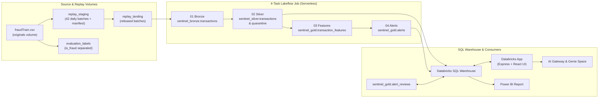

# Sentinel — Explainable Payment Monitoring & Investigation Prototype

Sentinel is an end-to-end **Databricks Data Engineer Associate** and full-stack learning prototype for monitoring card transactions, generating explainable rule alerts, and conducting human-in-the-loop investigations.

Rather than treating rule matches as automatic fraud verdicts or payment blocks, Sentinel treats every alert as **structured evidence for analyst review**.

## Intended Users

- **Data Engineering Learners & Interview Candidates**: Demonstrates an explainable Unity Catalog Medallion pipeline (`Bronze → Silver → Historical Features → Gold Alerts`) using Auto Loader, Delta Lake, Associate-level PySpark, and a 4-task Databricks Lakeflow Job.
- **Fraud & Risk Operations Analysts (Prototype Persona)**: Uses a React + TypeScript investigation console backed by Databricks SQL, Databricks AI Gateway, and Databricks Genie to inspect rule evidence, compare card baselines, ask natural-language data questions, and record review decisions.

---

## Application Preview

### 1. Review Queue, Filters & Loaded Summary Cards


### 2. Selected Investigation, Rule Evidence & AI Evidence Summary


### 3. Analyst Decision, 14-Day Amount Comparison & Earlier Card History


### 4. Expandable Source Lineage & Ask About the Data (Genie)


---

## Implemented Capabilities

- **Controlled Historical Replay & Label Separation**: Prepares 42 daily Parquet batches (`71,934` transactions from `fraudTrain.csv`), strips `is_fraud` into a separate evaluation volume before ingestion, and releases daily batches into an Auto Loader landing volume with holdout gating.
- **Governed Medallion Pipeline (Unity Catalog)**:
  - **Bronze (`workspace.sentinel_bronze.transactions`)**: Incremental Auto Loader (`cloudFiles`) ingestion with schema and checkpoint state and manifest row-count reconciliation.
  - **Silver (`workspace.sentinel_silver.transactions` & `quarantine`)**: Trims strings, validates timestamps (`TIMESTAMP_NTZ`) and 2-decimal amounts (`DECIMAL(18,2)`), classifies identical vs. conflicting duplicate `trans_num` records across the full Bronze history, removes personal cardholder attributes from accepted rows, and accounts for every Bronze row (`accepted + quarantine == Bronze`).
  - **Historical Features (`workspace.sentinel_gold.transaction_features`)**: Point-in-time prior card activity over strictly earlier windows (`[event_time - 1h, event_time)` and `[event_time - 14d, event_time)`) with zero future leakage.
  - **Monitoring Rules (`workspace.sentinel_gold.alerts`)**: Evaluates three frozen rules (`ruleset-v1.0-frozen`), attaches structured `rule_evidence` arrays, and generates deterministic SHA-256 `alert_id` keys.
- **Analyst Investigation Workspace (React + Express on Databricks Apps)**:
  - Filterable, selectable **Review Queue** (`ruleId` / `MULTI_RULE`, replay date range, search by transaction/card/merchant, and result cap up to `200` rows).
  - **Selected Investigation** view with plain-language rule evidence callouts, a horizontal SVG **Amount Comparison** chart (`amount`, `14d average`, `3× threshold`), `1h`/`14d` activity snapshot cards, **strictly earlier card history** (`event_time < alert.event_time`), and expandable source lineage.
  - **On-Demand AI Evidence Summaries** (`POST /api/alerts/:alertId/summary`) via Databricks AI Gateway (`system.ai.gpt-oss-120b`), using masked card numbers and excluding fraud labels.
  - **Ask About the Data (Genie)** (`POST /api/genie/ask`) via the Databricks Genie Conversation API, displaying natural-language answers alongside collapsible generated SQL and capped query results.
  - **Persistent Analyst Reviews** (`PUT /api/alerts/:alertId/review`) stored in `workspace.sentinel_gold.alert_reviews` via parameterized `MERGE INTO` (`Needs review`, `In review`, `Closed`, and notes up to `2,000` characters).
- **Power BI SQL Warehouse Consumer**: Imports `workspace.sentinel_silver.transactions`, `workspace.sentinel_gold.alerts`, and `workspace.sentinel_gold.alert_reviews` through the Databricks SQL Warehouse.

---

## Architecture Overview



---

## Technology Stack

| Layer | Technologies |
| --- | --- |
| **Data & Storage** | Databricks Unity Catalog (Volumes & Managed Delta Lake Tables), Spark SQL, Associate-level PySpark |
| **Ingestion & Orchestration** | Databricks Auto Loader (`cloudFiles`, `trigger(availableNow=True)`), 4-Task Databricks Lakeflow Job on Serverless compute |
| **Backend API** | Node.js (ESM), Express 5, `@databricks/sql` (`DBSQLClient` + `DBSQLParameter`), Service Principal OAuth (`/oidc/v1/token`) |
| **AI & BI Integrations** | Databricks AI Gateway (`system.ai.gpt-oss-120b`), Databricks Genie Conversation API, Power BI (via SQL Warehouse) |
| **Frontend UI** | React 19, TypeScript, Vite 8, plain CSS |

---

## Replay Scope & Verified Results

Sentinel replays a continuous 6-week slice of `fraudTrain.csv` (`2019-01-01 00:00:00` to `2019-02-12 00:00:00`, `71,934` total transactions across `42` dates) split into three chronological 14-day periods:

### 1. Cumulative Replay & Pipeline Totals (Verified in Databricks)

| Scope | Replay Batches | Accepted Silver Rows | Quarantined Rows | Flagged Gold Alerts (`ruleset-v1.0-frozen`) |
| --- | --- | --- | --- | --- |
| **Initial Single-Day Smoke Test (`2019-01-01`)** | `1` | `2,414` | `0` | `21` (`1` velocity, `20` unusual amount, `0` similar merchant) |
| **Pre-Evaluation Release (`2019-01-01` – `2019-01-28`)** | `28` | `47,875` | `0` | `2,719` |
| **Complete 42-Day Replay (`2019-01-01` – `2019-02-11`)** | `42` | `71,934` | `0` | `4,142` (`2,719` Jan 1–28 + `1,423` Jan 29–Feb 11) |

*(Silver validation rules were also verified against synthetic test fixtures covering missing/blank identifiers, malformed/3-decimal/non-positive amounts, rescued data, and identical vs. conflicting duplicate `trans_num` values.)*

### 2. Period-Specific Breakdown & Holdout Evaluation Metrics

| Period | Date Range | Transactions | Purpose & Confirmed Metrics |
| --- | --- | --- | --- |
| **1. Initial History** | `2019-01-01` – `2019-01-14` (`14` days) | `24,144` | Establishes the 14-day card activity baseline (`1,343` alerts generated during warm-up). |
| **2. Rule Development** | `2019-01-15` – `2019-01-28` (`14` days) | `23,731` | Used to inspect rule behavior without labels before freezing thresholds: **`1,376` flagged alerts (`5.8%`)** — `25` Rule 1 (1h velocity), `1,356` Rule 2 (14d unusual amount), `0` Rule 3 (1h similar merchant), including `5` multi-rule alerts. |
| **3. Holdout Evaluation** | `2019-01-29` – `2019-02-11` (`14` days) | `24,059` | Evaluated once in [`pipelines/05_rule_evaluation.ipynb`](./pipelines/05_rule_evaluation.ipynb) against separated labels (`256` actual fraud rows): **`1,423` flagged alerts**, **`TP = 116`**, **`FP = 1,307`**, **`FN = 140`**, **`TN = 22,496`**, **Precision = `8.15%` (`0.0815`)**, **Recall = `45.31%` (`0.4531`)**. |

---

## Repository Structure

```text
├── app/
│   ├── app.yaml                        # Databricks App command & resource bindings
│   ├── package.json                    # App build & start scripts
│   ├── backend/
│   │   ├── server.js                   # Express API routes & static SPA hosting
│   │   ├── sql.js                      # Parameterized Databricks SQL queries & review MERGE
│   │   ├── ai.js                       # OAuth token client & AI Gateway evidence summary
│   │   └── genie.js                    # Databricks Genie Conversation API polling client
│   └── frontend/
│       └── src/
│           ├── App.tsx                 # Main workspace state, filters, and unsaved-edit guards
│           ├── components/             # AlertFiltersBar, AlertQueuePane, AlertDetailPane,
│           │                           # AnalystReviewForm, AskGeniePanel, SafeMarkdownText
│           ├── types/alerts.ts         # TypeScript API & domain contracts
│           └── utils/formatters.ts     # Card masking, currency, and plain-language evidence helpers
├── explorations/
│   └── 01_source_assesment.ipynb       # Read-only profiling of raw fraudTrain.csv & fraudTest.csv
├── resources/
│   └── 01_source_storage.sql           # DDL for workspace.sentinel_sources.originals volume
├── scripts/
│   ├── 02_prepare_replay.ipynb         # Splits 42 daily batches, manifest, and separate fraud labels
│   └── 03_release_replay.ipynb         # Releases daily batches to landing with holdout gating
├── pipelines/
│   ├── 01_bronze_transactions.ipynb    # Task 1: Auto Loader ingestion to Bronze Delta table
│   ├── 02_silver_transactions.ipynb    # Task 2: Validation, duplicate routing & Silver/Quarantine tables
│   ├── 03_historical_features.ipynb    # Task 3: Point-in-time 1h & 14d card features table
│   ├── 04_monitoring_rules.ipynb       # Task 4: Frozen ruleset evaluation & Gold alerts table
│   ├── 05_rule_evaluation.ipynb        # Holdout evaluation joining Gold alerts with separate labels
│   └── historical_features.py          # Legacy pre-refactor helper (retained; not used by Job)
├── tests/                              # Equivalence check & legacy test notebooks
└── docs/                               # Architecture, setup, dataset assessment, and verification docs
```

---

## Quick Start & Documentation Links

1. **Local Frontend & Backend Build**:
   ```bash
   cd app
   npm install
   npm run build
   npm start
   ```
   *(Requires Databricks environment variables for live SQL/AI/Genie endpoints; see the setup guide below.)*

2. **Detailed Documentation**:
   - **[Architecture, Setup & Deployment Guide (`docs/architecture.md`)](./docs/architecture.md)** — Full component map, environment variable names, Databricks App resources, service-principal permissions, 4-task Lakeflow Job order, and GitHub-to-Databricks deployment steps.
   - **[Verification Results & Demo Guide (`docs/validation-results.md`)](./docs/validation-results.md)** — Confirmed Databricks pipeline checks, live browser verification results, demo walkthrough flow, and remaining unconfirmed checks.
   - **[Dataset Assessment & Replay Split (`docs/dataset-assessment.md`)](./docs/dataset-assessment.md)** — Source CSV profiling findings, `_rescued_data._c0` lineage, `unix_time` offset findings, and the 42-day chronological split.
   - **[Build Journal (`docs/build-journal.md`)](./docs/build-journal.md)** — Phase-by-phase engineering progression and key implementation decisions.
   - **[Associate-Level PySpark Refactor Guide (`docs/REFACTOR_GUIDE.md`)](./docs/REFACTOR_GUIDE.md)** — How the Silver, Features, and Rules notebooks were simplified to Associate-level PySpark and verified via `exceptAll == 0`.

---

## Prototype Limitations & Remaining Checks

- **Prototype Scope & Rule Baseline**: The frozen ruleset (`ruleset-v1.0-frozen`) is an intentionally simple 3-rule baseline (`8.15%` precision, `45.31%` recall on holdout data; `RULE_03` had `0` matches in development). Thresholds are frozen to demonstrate honest holdout evaluation rather than label-tuned optimization.
- **Full-Snapshot `overwrite` in Silver & Gold**: Bronze ingests incrementally via Auto Loader (`append`), while Silver, Historical Features, and Gold Alerts recompute via full-snapshot `overwrite` across the `71,934`-row dataset so cross-batch duplicate ID conflicts are handled simply.
- **Bounded API Responses**: `/api/alerts` is capped at `200` rows (default `50`) and `/api/alerts/:alertId/history` is capped at `100` rows (default `25`). UI summary cards explicitly describe **loaded results**.
- **Single-Row Review Storage**: `workspace.sentinel_gold.alert_reviews` stores one current review per `alert_id` via `MERGE INTO` without audit history, user attribution, or concurrent-edit locking.
- **Remaining Unconfirmed Checks**:
  - Live test of **Genie follow-up questions** (`POST /api/genie/ask` with an active `conversationId`).
  - Confirming that saved reviews in `workspace.sentinel_gold.alert_reviews` remain intact and joined after **rerunning the 4-task Lakeflow Job**.
  - Confirming **Power BI shared-date filtering** across imported tables (`transactions`, `alerts`, `alert_reviews`).
  - Browser regression check following the extraction of `AnalystReviewForm.tsx`.
