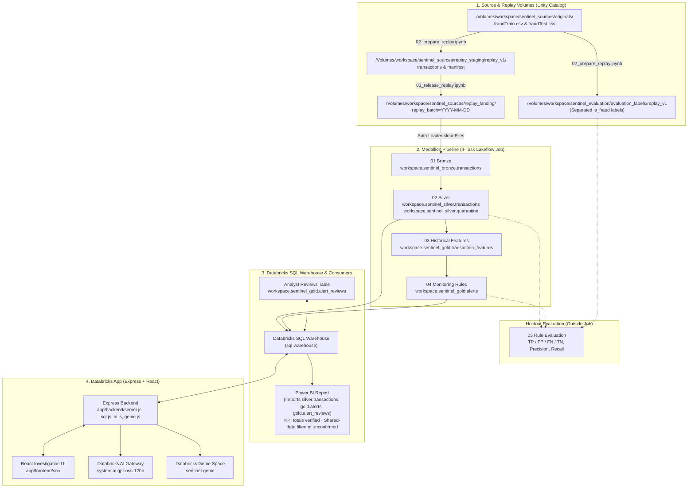

# Sentinel Architecture, Setup & Deployment Guide

- **Last Updated**: 2026-11-13
- **Role**: Architect / Technical Writer
- **Branch**: `feat/phase-3-investigation-ui`
- **Target Level**: Databricks Data Engineer Associate (explainable SQL, PySpark, Express, and React without hidden helpers or extra frameworks)

---

## 1. End-to-End Architecture Flow



---

## 2. Component Inventory: Purpose, Files, Inputs, and Outputs

### A. Source Assessment & Replay Preparation

| Component | Actual File | Purpose | Inputs | Outputs |
| --- | --- | --- | --- | --- |
| **Source Storage DDL** | [`resources/01_source_storage.sql`](../resources/01_source_storage.sql) | Creates schema `workspace.sentinel_sources` and volume `workspace.sentinel_sources.originals` for raw CSV uploads. | None | Unity Catalog volume `/Volumes/workspace/sentinel_sources/originals`. |
| **Source Assessment** | [`explorations/01_source_assesment.ipynb`](../explorations/01_source_assesment.ipynb) | Read-only profiling of raw CSVs (`1,852,394` rows), schema/rescued-data inspection (`_c0`), and selection of the 42-day window (`71,934` rows). | `/Volumes/workspace/sentinel_sources/originals/fraudTrain.csv`, `fraudTest.csv` | Assessment findings documented in [`docs/dataset-assessment.md`](./dataset-assessment.md) (no data modified). |
| **Prepare Replay** | [`scripts/02_prepare_replay.ipynb`](../scripts/02_prepare_replay.ipynb) | Extracts Jan 1–Feb 11, 2019 (`71,934` rows), strips `is_fraud` from operational records, extracts `source_row_index` from `_rescued_data._c0`, and writes partitioned daily Parquet batches plus a count manifest. | `/Volumes/workspace/sentinel_sources/originals/fraudTrain.csv` | 1. `/Volumes/workspace/sentinel_sources/replay_staging/replay_v1/transactions` (`is_fraud` removed)<br>2. `/Volumes/workspace/sentinel_sources/replay_staging/replay_v1/manifest` (`42` daily counts + period labels)<br>3. `/Volumes/workspace/sentinel_evaluation/evaluation_labels/replay_v1` (`trans_num`, `is_fraud`, `replay_batch`, `source_file`) |
| **Release Replay** | [`scripts/03_release_replay.ipynb`](../scripts/03_release_replay.ipynb) | Copies staged daily Parquet folders into the landing volume without overwriting existing dates so Auto Loader checkpoints stay valid. Enforces holdout gating via `RELEASE_EVALUATION_BATCHES`. | `/Volumes/workspace/sentinel_sources/replay_staging/replay_v1/transactions` and `manifest` | `/Volumes/workspace/sentinel_sources/replay_landing/replay_batch=YYYY-MM-DD` (`28` batches / `47,875` rows by default; `42` batches / `71,934` rows when evaluation batches are enabled). |

### B. Medallion Pipeline & Evaluation Notebooks

| Component | Actual File | Purpose | Inputs | Outputs |
| --- | --- | --- | --- | --- |
| **Bronze Ingestion** | [`pipelines/01_bronze_transactions.ipynb`](../pipelines/01_bronze_transactions.ipynb) | Incrementally ingests released Parquet files using Auto Loader (`cloudFiles`, `trigger(availableNow=True)`), appends `_ingested_file_path` and `_ingestion_timestamp`, and reconciles daily counts against the manifest. | `/Volumes/workspace/sentinel_sources/replay_landing`, `/Volumes/workspace/sentinel_sources/replay_staging/replay_v1/manifest` | `workspace.sentinel_bronze.transactions` (`append` mode) and Auto Loader state in `/Volumes/workspace/sentinel_bronze/ingestion_state/transactions_v1`. |
| **Silver Validation & Quarantine** | [`pipelines/02_silver_transactions.ipynb`](../pipelines/02_silver_transactions.ipynb) | Trims strings, validates required fields, parses `event_time` (`TIMESTAMP_NTZ`) and `amount` (`DECIMAL(18,2)` with `AMOUNT_PATTERN`), classifies duplicate `trans_num` values via `collect_set(struct(*BUSINESS_COLUMNS))` windowing, strips PII from accepted rows, and verifies `accepted + quarantine == Bronze`. | `workspace.sentinel_bronze.transactions`, replay manifest | `workspace.sentinel_silver.transactions` (`overwrite`, 11 columns, 1 row per accepted `trans_num`) and `workspace.sentinel_silver.quarantine` (`overwrite`, rejected and `duplicate_identical` rows with `validation_reasons`). |
| **Historical Features** | [`pipelines/03_historical_features.ipynb`](../pipelines/03_historical_features.ipynb) | Computes point-in-time prior card activity (`1h` and `14d` counts, `14d` average amount, `1h` same-merchant count, and `1h` ±10% similar-amount count) using a left self-join on `cc_num` where `prev_event_time < event_time`. | `workspace.sentinel_silver.transactions` | `workspace.sentinel_gold.transaction_features` (`overwrite`, 1 row per `trans_num`). |
| **Monitoring Rules → Gold Alerts** | [`pipelines/04_monitoring_rules.ipynb`](../pipelines/04_monitoring_rules.ipynb) | Evaluates 3 frozen rules (`RULE_01_CARD_VELOCITY_1H`, `RULE_02_UNUSUAL_AMOUNT_14D`, `RULE_03_REPEATED_SIMILAR_MERCHANT_1H` under `ruleset-v1.0-frozen`), builds `rule_evidence` struct arrays, and generates deterministic SHA-256 `alert_id` values. | `workspace.sentinel_gold.transaction_features` | `workspace.sentinel_gold.alerts` (`overwrite`, 23 columns, 1 row per flagged transaction: `2,719` rows for Jan 1–28; `4,142` rows across all 42 days). |
| **Frozen-Rule Evaluation** | [`pipelines/05_rule_evaluation.ipynb`](../pipelines/05_rule_evaluation.ipynb) | Evaluates holdout performance (Jan 29–Feb 11, 2019; `24,059` transactions) in memory by joining Silver transactions, Gold alerts, and separated fraud labels without writing `is_fraud` to any operational table. | `workspace.sentinel_silver.transactions`, `workspace.sentinel_gold.alerts`, `/Volumes/workspace/sentinel_evaluation/evaluation_labels/replay_v1`, manifest | In-notebook evaluation metrics (`TP = 116`, `FP = 1,307`, `FN = 140`, `TN = 22,496`, `precision = 0.0815`, `recall = 0.4531`). |

### C. Application Backend, React UI, AI/Genie, Saved Reviews & Power BI

| Component | Actual File | Purpose | Inputs | Outputs |
| --- | --- | --- | --- | --- |
| **App Manifest & Build Config** | [`app/app.yaml`](../app/app.yaml), [`app/package.json`](../app/package.json) | Configures Databricks Apps startup command (`npm start`) and binds environment variables (`DATABRICKS_WAREHOUSE_ID`, `SENTINEL_AI_MODEL`, `SENTINEL_GENIE_SPACE_ID`). | App resource bindings (`sql-warehouse`, `sentinel-genie`) | Runtime environment variables injected into the Node.js process. |
| **Express Server** | [`app/backend/server.js`](../app/backend/server.js) | Serves the compiled React SPA (`app/frontend/dist`) and exposes REST endpoints for health checks, alerts, card history, review saves, AI summaries, and Genie questions. | HTTP requests from the React client | JSON API responses (`/api/health`, `/api/health/sql`, `/api/alerts`, `/api/alerts/:alertId/history`, `PUT /api/alerts/:alertId/review`, `POST /api/alerts/:alertId/summary`, `POST /api/genie/ask`, `POST /api/checks/ai`). |
| **SQL Data Access & Review Persistence** | [`app/backend/sql.js`](../app/backend/sql.js) | Executes parameterized SQL via `@databricks/sql` (`DBSQLClient` + `DBSQLParameter`). Reads alerts left-joined with deduplicated `alert_reviews`, reads strictly earlier card history (`event_time < alert.event_time`), and upserts reviews via `MERGE INTO`. | Query/path/body parameters; reads `workspace.sentinel_gold.alerts`, `workspace.sentinel_silver.transactions`, `workspace.sentinel_gold.alert_reviews` | Normalized JSON-safe records (decimal strings, `yyyy-MM-dd HH:mm:ss` timestamps, parsed JSON arrays) and upserted rows in `workspace.sentinel_gold.alert_reviews`. |
| **AI Evidence Summary Client** | [`app/backend/ai.js`](../app/backend/ai.js) | Obtains workspace OAuth token (`/oidc/v1/token`), masks card numbers (`•••• 1234`), packages the selected alert + up to 10 earlier transactions as data-only JSON, and requests a 3-part plain-text summary from Databricks AI Gateway. | Selected alert and up to 10 earlier Silver transactions from `fetchAlertHistory`; `SENTINEL_AI_MODEL` | Short explanation (`Why flagged`, `Supporting facts/thresholds`, `Limitations`) from `${workspaceUrl}/ai-gateway/mlflow/v1/chat/completions`. |
| **Genie Conversation Client** | [`app/backend/genie.js`](../app/backend/genie.js) | Starts or continues a Genie conversation (`/api/2.0/genie/spaces/{spaceId}`), polls message status (`1.5s` interval, `60s` timeout), and retrieves the text answer, generated SQL, and query result attachment (capped at `20` rows). | `{ question, conversationId }`, `SENTINEL_GENIE_SPACE_ID`, OAuth token from `fetchDatabricksWorkspaceAuth` | `{ conversationId, messageId, question, answer, sql, columns, rows, displayedRowCount, totalRowCount, rowCap }`. |
| **React Investigation Workspace** | [`app/frontend/src/App.tsx`](../app/frontend/src/App.tsx), [`AlertFiltersBar.tsx`](../app/frontend/src/components/AlertFiltersBar.tsx), [`AlertQueuePane.tsx`](../app/frontend/src/components/AlertQueuePane.tsx), [`AlertDetailPane.tsx`](../app/frontend/src/components/AlertDetailPane.tsx), [`AnalystReviewForm.tsx`](../app/frontend/src/components/AnalystReviewForm.tsx), [`AskGeniePanel.tsx`](../app/frontend/src/components/AskGeniePanel.tsx), [`SafeMarkdownText.tsx`](../app/frontend/src/components/SafeMarkdownText.tsx), [`formatters.ts`](../app/frontend/src/utils/formatters.ts), [`alerts.ts`](../app/frontend/src/types/alerts.ts) | Two-stage analyst console: sidebar rule filters, loaded-result summary cards, filter bar, selectable review queue table, selected alert evidence callouts, SVG amount comparison bar chart, AI summary section, Analyst Decision form (`AnalystReviewForm.tsx`, with unsaved-edit guards), earlier card history table, expandable lineage, and Ask about the data (Genie) panel. | JSON responses from Express endpoints; user interactions | Rendered DOM (`app/frontend/dist` static bundle); `PUT` review updates and `POST` summary/Genie requests. |
| **Power BI Report (BI Consumer)** | External Power BI report connected to Databricks SQL Warehouse | Separate read-only BI consumer importing transactions, alerts, and reviews via the SQL Warehouse. KPI totals were verified; shared-date filtering remains unconfirmed. | Imports `workspace.sentinel_silver.transactions`, `workspace.sentinel_gold.alerts`, and `workspace.sentinel_gold.alert_reviews` via Databricks SQL Warehouse | Power BI report with verified KPI totals (shared-date filtering unconfirmed). |

---

## 3. Setup, Execution Order, Authentication & Deployment

### A. Prerequisites
- **Databricks Workspace** with Unity Catalog enabled (catalog `workspace`), Serverless Notebook & Job compute, a **SQL Warehouse**, **Databricks Apps**, **AI Gateway** access (`system.ai.gpt-oss-120b`), and a **Databricks Genie Space** configured over the Sentinel tables.
- **Source Dataset**: Download `fraudTrain.csv` (and optionally `fraudTest.csv`) from the [Kaggle Credit Card Transactions Fraud Detection Dataset (kartik2112, CC0)](https://www.kaggle.com/datasets/kartik2112/fraud-detection).
- **Local Development Tools**: Node.js `>= 20` and `npm`.

### B. Step-by-Step Data Preparation & Lakeflow Job Order

1. **Create Source Storage & Upload Raw CSVs**:
   - Run [`resources/01_source_storage.sql`](../resources/01_source_storage.sql) in Databricks SQL to create `workspace.sentinel_sources.originals`.
   - Upload `fraudTrain.csv` (and `fraudTest.csv`) to `/Volumes/workspace/sentinel_sources/originals/`.
   - *(Optional)* Run [`explorations/01_source_assesment.ipynb`](../explorations/01_source_assesment.ipynb) to inspect source profiling queries.
2. **Prepare Staged Daily Replay Batches & Separate Fraud Labels**:
   - Run [`scripts/02_prepare_replay.ipynb`](../scripts/02_prepare_replay.ipynb) on Serverless compute. This writes `42` daily Parquet batches and the `manifest` to `/Volumes/workspace/sentinel_sources/replay_staging/replay_v1` and writes separated `is_fraud` labels to `/Volumes/workspace/sentinel_evaluation/evaluation_labels/replay_v1`.
3. **Release Replay Batches into Landing**:
   - Run [`scripts/03_release_replay.ipynb`](../scripts/03_release_replay.ipynb).
   - With `RELEASE_EVALUATION_BATCHES = False` (default), it releases the `28` pre-evaluation batches (`2019-01-01` – `2019-01-28`, `47,875` rows) into `/Volumes/workspace/sentinel_sources/replay_landing`.
   - After rule thresholds are frozen (`ruleset-v1.0-frozen`), set `RELEASE_EVALUATION_BATCHES = True` and rerun to release the remaining `14` holdout evaluation batches (`2019-01-29` – `2019-02-11`, `71,934` total rows).
4. **Execute the 4-Task Databricks Lakeflow Job**:
   Configure and run a Databricks Lakeflow Job on Serverless compute with these four sequential notebook tasks:
   - **Task 1 (`01_bronze_transactions`)**: [`pipelines/01_bronze_transactions.ipynb`](../pipelines/01_bronze_transactions.ipynb) — Auto Loader incremental `append` to `workspace.sentinel_bronze.transactions`.
   - **Task 2 (`02_silver_transactions`)** *(depends on Task 1)*: [`pipelines/02_silver_transactions.ipynb`](../pipelines/02_silver_transactions.ipynb) — Full-snapshot `overwrite` of `workspace.sentinel_silver.transactions` and `workspace.sentinel_silver.quarantine`.
   - **Task 3 (`03_historical_features`)** *(depends on Task 2)*: [`pipelines/03_historical_features.ipynb`](../pipelines/03_historical_features.ipynb) — Full-snapshot `overwrite` of `workspace.sentinel_gold.transaction_features`.
   - **Task 4 (`04_monitoring_rules`)** *(depends on Task 3)*: [`pipelines/04_monitoring_rules.ipynb`](../pipelines/04_monitoring_rules.ipynb) — Full-snapshot `overwrite` of `workspace.sentinel_gold.alerts`.
5. **Run Holdout Rule Evaluation (Outside Recurring Job)**:
   - Once all `42` batches are ingested and processed, run [`pipelines/05_rule_evaluation.ipynb`](../pipelines/05_rule_evaluation.ipynb) to compute holdout `TP`, `FP`, `FN`, `TN`, `precision`, and `recall` on `2019-01-29` – `2019-02-11`.
6. **Create the Analyst Reviews Table**:
   - Run the following DDL once in the Databricks SQL Editor before saving analyst reviews from the UI:
     ```sql
     CREATE TABLE IF NOT EXISTS workspace.sentinel_gold.alert_reviews (
       alert_id STRING NOT NULL,
       review_status STRING NOT NULL,
       review_notes STRING,
       updated_at TIMESTAMP NOT NULL
     )
     USING DELTA;
     ```

### C. Environment Variables (Names Only — Never Commit Secrets)

In Databricks Apps, platform credentials are injected automatically and resource IDs are bound via [`app/app.yaml`](../app/app.yaml). For local execution, set the following environment variables in your shell (never commit `.env` files or secrets):

| Environment Variable | Source in Databricks Apps | Purpose |
| --- | --- | --- |
| `DATABRICKS_HOST` | Injected automatically by Databricks Apps | Workspace hostname (e.g., `dbc-xxxx.cloud.databricks.com`, with or without `https://`) |
| `DATABRICKS_CLIENT_ID` | Injected automatically by Databricks Apps | App service principal OAuth client ID |
| `DATABRICKS_CLIENT_SECRET` | Injected automatically by Databricks Apps | App service principal OAuth client secret |
| `DATABRICKS_WAREHOUSE_ID` | `valueFrom: sql-warehouse` in `app/app.yaml` | SQL Warehouse ID used by `@databricks/sql` (`DBSQLClient`) |
| `SENTINEL_AI_MODEL` | `value: system.ai.gpt-oss-120b` in `app/app.yaml` | Model serving / AI Gateway endpoint name for `/api/alerts/:alertId/summary` |
| `SENTINEL_GENIE_SPACE_ID` | `valueFrom: sentinel-genie` in `app/app.yaml` | Genie space ID used by `/api/genie/ask` |
| `DATABRICKS_APP_PORT` / `PORT` | Injected by Databricks Apps (fallback `8000`) | HTTP port for the Express server |

### D. Frontend Build & Backend Startup

From the repository root:

```bash
# 1. Install backend dependencies (@databricks/sql, express)
cd app
npm install

# 2. Lint and build the React + TypeScript frontend into app/frontend/dist/
npm --prefix frontend ci --include=dev
npm --prefix frontend run lint
npm --prefix frontend run build
# (Or simply run `npm run build` from inside `app/`)

# 3. Start the Express server (serves app/frontend/dist and /api/* on port 8000)
npm start
```

### E. Databricks App Resources & Service Principal Permissions

1. **Configure App Resources in Databricks Apps**:
   - **`sql-warehouse`**: Attach your Databricks SQL Warehouse with resource key `sql-warehouse` (`CAN USE`).
   - **`sentinel-genie`**: Attach your Databricks Genie Space with resource key `sentinel-genie` (`CAN RUN` / `CAN VIEW`).
   - **AI Model Serving**: Ensure the app service principal has `CAN QUERY` on `system.ai.gpt-oss-120b`.
2. **Grant Unity Catalog Privileges to the App Service Principal**:
   ```sql
   GRANT USE CATALOG ON CATALOG workspace TO `<app-service-principal-client-id>`;
   GRANT USE SCHEMA ON SCHEMA workspace.sentinel_silver TO `<app-service-principal-client-id>`;
   GRANT USE SCHEMA ON SCHEMA workspace.sentinel_gold TO `<app-service-principal-client-id>`;
   GRANT SELECT ON TABLE workspace.sentinel_silver.transactions TO `<app-service-principal-client-id>`;
   GRANT SELECT ON TABLE workspace.sentinel_gold.alerts TO `<app-service-principal-client-id>`;
   GRANT SELECT, MODIFY ON TABLE workspace.sentinel_gold.alert_reviews TO `<app-service-principal-client-id>`;
   ```

| Principal / Consumer | Resource | Required Privilege / Permission |
| --- | --- | --- |
| **Databricks App Service Principal** | Catalog `workspace` | `USE CATALOG` |
| **Databricks App Service Principal** | Schemas `sentinel_silver`, `sentinel_gold` | `USE SCHEMA` |
| **Databricks App Service Principal** | `workspace.sentinel_silver.transactions`, `workspace.sentinel_gold.alerts` | `SELECT` |
| **Databricks App Service Principal** | `workspace.sentinel_gold.alert_reviews` | `SELECT`, `MODIFY` (required for `MERGE INTO`) |
| **Databricks App Service Principal** | SQL Warehouse (`sql-warehouse`) | `CAN USE` |
| **Databricks App Service Principal** | AI Model Endpoint (`system.ai.gpt-oss-120b`) | `CAN QUERY` |
| **Databricks App Service Principal** | Genie Space (`sentinel-genie`) | `CAN RUN` / `CAN VIEW` on the Genie space and `SELECT` on underlying tables |
| **Power BI Principal / User** | SQL Warehouse + imported tables | `CAN USE` on SQL Warehouse; `USE CATALOG` on `workspace`; `USE SCHEMA` on `sentinel_silver` and `sentinel_gold`; `SELECT` on `workspace.sentinel_silver.transactions`, `workspace.sentinel_gold.alerts`, and `workspace.sentinel_gold.alert_reviews` |

### F. GitHub-to-Databricks Deployment Workflow

1. **Local Development & Verification**:
   - Edit code or notebooks in VS Code.
   - Run `npm --prefix app/frontend run lint` and `npm --prefix app/frontend run build` locally to verify TypeScript compilation and bundle output.
2. **Push to GitHub**:
   - Commit changes to the feature or main branch and push to the GitHub repository.
3. **Pull in Databricks Git Folder**:
   - In the Databricks workspace, open the connected **Git folder** (Repos) and pull the latest commit on the same branch.
4. **Run / Update Notebooks or Deploy App**:
   - For pipeline changes: Execute the notebooks or the 4-task Lakeflow Job on Serverless compute and inspect the assertion outputs.
   - For application changes: In **Compute → Apps**, select the Sentinel app and click **Deploy**, pointing to the `app` subfolder inside the synced Databricks Git folder. Databricks Apps runs the build (`app/package.json`) and starts `node backend/server.js` using [`app/app.yaml`](../app/app.yaml).

---

## 4. Concrete Opportunities to Simplify or Clarify Code (Up to 5)

To keep the codebase easy to explain at an Associate level without introducing new frameworks or helper abstractions, opportunities are separated into **behavior-preserving refactors** and **requirement changes**.

### Part A — Behavior-Preserving Refactors

#### 1. Remove Obsolete Pre-Refactor Legacy Files (`pipelines/historical_features.py` & Legacy Test Notebooks)
- **Files**: [`pipelines/historical_features.py`](../pipelines/historical_features.py), [`tests/02_silver_transactions_tests.ipynb`](../tests/02_silver_transactions_tests.ipynb), [`tests/04_monitoring_rules_tests.ipynb`](../tests/04_monitoring_rules_tests.ipynb), and [`tests/00_refactor_equivalence_check.ipynb`](../tests/00_refactor_equivalence_check.ipynb).
- **Issue**: [`pipelines/historical_features.py`](../pipelines/historical_features.py) is no longer imported by any active pipeline notebook, yet it still contains the pre-refactor epoch-second `rangeBetween(-3600, -1)` windows and `collect_list` + `F.filter(..., lambda ...)` higher-order functions that `.ace/standards/pyspark-associate-level.md` specifically replaced. Similarly, the old test notebooks duplicate pipeline logic that is now tested directly inside notebooks `02`, `03`, and `04`.
- **Simplification**: Follow Step 6 of [`docs/REFACTOR_GUIDE.md`](./REFACTOR_GUIDE.md) and delete these unused legacy files when ready, since Databricks equivalence (`exceptAll == 0`) and the 4-task Lakeflow Job have passed.

#### 2. Reuse One Session per Multi-Statement Call in `app/backend/sql.js`
- **File**: [`app/backend/sql.js`](../app/backend/sql.js) (`executeSqlStatement`, `fetchAlertHistory`, `saveAlertReview`).
- **Issue**: `executeSqlStatement` opens and closes a brand-new `DBSQLClient` and warehouse session for every single SQL statement. As a result, `fetchAlertHistory` opens 2 consecutive connections, `POST /api/alerts/:alertId/summary` opens 2 connections, and `saveAlertReview` opens **3 consecutive connections** (`SELECT` alert existence → `MERGE INTO` review → `SELECT` saved review).
- **Simplification**: Run multi-statement operations on one opened session (or return the saved review fields directly) to cut warehouse round-trips without changing the API response.

#### 3. Unify Duplicated Route Error Handling in `app/backend/server.js`
- **File**: [`app/backend/server.js`](../app/backend/server.js).
- **Issue**: `handleSqlRouteError` handles `400` validation errors vs. `503` `Missing configuration:` errors for SQL routes, while `POST /api/alerts/:alertId/summary` and `POST /api/genie/ask` repeat the same 20-line `if (error?.statusCode === 400) ... isConfigurationError ... return response.status(503)` block inline.
- **Simplification**: Pass a short fallback message into `handleRouteError(routeLabel, fallbackMessage, error, response)` and use it across all SQL, AI, and Genie routes in [`app/backend/server.js`](../app/backend/server.js).

#### 4. Consolidate Duplicate UI Error Readers (`App.tsx` & `AskGeniePanel.tsx`)
- **Files**: [`app/frontend/src/App.tsx`](../app/frontend/src/App.tsx), [`app/frontend/src/components/AskGeniePanel.tsx`](../app/frontend/src/components/AskGeniePanel.tsx), [`app/frontend/src/components/AnalystReviewForm.tsx`](../app/frontend/src/components/AnalystReviewForm.tsx), and [`app/frontend/src/utils/formatters.ts`](../app/frontend/src/utils/formatters.ts).
- **Status**: `getReviewStatusBadgeClass` has been consolidated in [`formatters.ts`](../app/frontend/src/utils/formatters.ts) and the Analyst Decision form has been extracted into [`AnalystReviewForm.tsx`](../app/frontend/src/components/AnalystReviewForm.tsx).
- **Remaining Simplification**: `readErrorMessage` (`App.tsx`) and `readGenieError` (`AskGeniePanel.tsx`) are still identical 14-line JSON error-message readers that can share one small utility function.

---

### Part B — Optional Requirement Changes (Not Pure Refactors)

#### 5. Mask `cc_num` Server-Side on All Alert & History Endpoints (Contract Change)
- **Files**: [`app/backend/sql.js`](../app/backend/sql.js) (`normalizeGoldAlertRow`, `normalizeHistoryRow`), [`app/backend/ai.js`](../app/backend/ai.js) (`maskCardIdentifier`), and [`app/frontend/src/utils/formatters.ts`](../app/frontend/src/utils/formatters.ts) (`maskCardNumber`).
- **Current Behavior**: `POST /api/alerts/:alertId/summary` masks card numbers on the backend before calling the AI model, whereas `GET /api/alerts` and `GET /api/alerts/:alertId/history` send full `cc_num` strings to the browser and mask them in React (`maskCardNumber`).
- **Why This Is a Requirement Change**: Masking `cc_num` inside `normalizeGoldAlertRow` and `normalizeHistoryRow` on the backend (after SQL uses `a.cc_num` for `LIKE` search and history joins) would prevent full card numbers from ever leaving the server and allow removing duplicate masking logic—**but** it changes the JSON API payload returned by `/api/alerts` and `/api/alerts/:alertId/history`.

---

## 5. Known Limitations and Verification Gaps

### A. Known Prototype & Data Limitations
1. **High False-Positive Baseline (`ruleset-v1.0-frozen`)**: On the Jan 29–Feb 11 holdout period (`24,059` transactions), precision is `8.15%` (`116` TP vs. `1,307` FP) and recall is `45.31%` (`140` FN), and `RULE_03_REPEATED_SIMILAR_MERCHANT_1H` matched `0` transactions in development. Thresholds are intentionally frozen to preserve evaluation integrity.
2. **Full-Snapshot `overwrite` Rebuild in Silver & Gold**: Notebooks `02`, `03`, and `04` rebuild their target Delta tables from all ingested Bronze rows (`overwrite`). This is simple to explain and handles retroactive duplicate conflicts across batches on `71,934` rows, but is not an incremental streaming Gold pipeline.
3. **Bounded API Results Without Pagination**: `GET /api/alerts` returns at most `200` rows (default `50`) and `GET /api/alerts/:alertId/history` returns at most `100` rows (default `25`). Summary cards in the UI reflect **loaded results**, not full-table counts.
4. **Single-Row Overwrite for Analyst Reviews**: `workspace.sentinel_gold.alert_reviews` stores one current status and note per `alert_id` via `MERGE INTO` without audit history, analyst user attribution, or optimistic concurrency locking.
5. **Source Dataset Artifacts**: `trans_date_trans_time` has an unspecified timezone (`TIMESTAMP_NTZ`), and the raw `unix_time` discrepancy noted during Phase 1 assessment remains unexplained (preserved in Bronze and quarantine only).

### B. Live Verification Status and Remaining Gaps
1. **Confirmed Live Databricks App Checks**:
   - **Read-Only Queue, Details, Chart, History & Filters**: Confirmed in live browser checks.
   - **Step 3E — Evidence Summaries (`POST /api/alerts/:alertId/summary`)**: Live generation tested and confirmed against the Databricks AI Gateway endpoint.
   - **Step 3F — Ask Genie (`POST /api/genie/ask`)**: Live initial questions tested and confirmed against the `sentinel-genie` space.
   - **Step 3G — Analyst Reviews (`PUT /api/alerts/:alertId/review`)**: Live review save/update, page-refresh persistence, and per-alert isolation tested and passed.
   - **Power BI Report**: Imports `workspace.sentinel_silver.transactions`, `workspace.sentinel_gold.alerts`, and `workspace.sentinel_gold.alert_reviews`; KPI totals were verified.
2. **Remaining Unconfirmed Items / Verification Gaps**:
   - **Genie Follow-Up Questions**: Follow-up messages using an active `conversationId` in `POST /api/genie/ask` remain unconfirmed in live testing.
   - **Review Survival After Pipeline Rerun**: Confirming that saved rows in `workspace.sentinel_gold.alert_reviews` remain intact and properly joined after rerunning the 4-task Lakeflow Job (which overwrites `workspace.sentinel_gold.alerts` with deterministic `alert_id` hashes) remains unconfirmed.
   - **Power BI Shared-Date Filtering**: Shared-date filtering across the imported tables (`transactions`, `alerts`, `alert_reviews`) in Power BI remains unconfirmed.
   - **Frontend Cleanup Regression Check**: Browser regression check after extracting `AnalystReviewForm.tsx` and consolidating `getReviewStatusBadgeClass`.
   - **No Automated CI Test Runner**: `app/package.json` has `build` and `start` scripts (`npm --prefix app/frontend run lint` and `build`), but no automated `npm test` script or configured ACE test runner.
